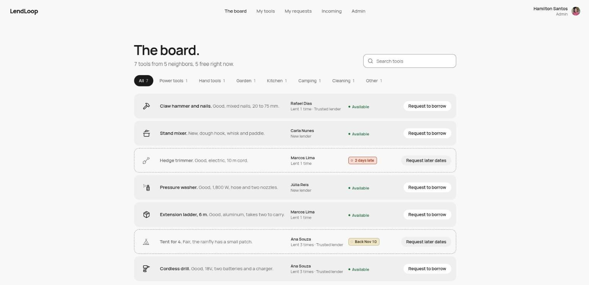
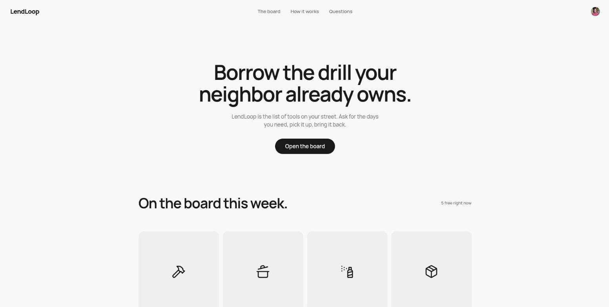
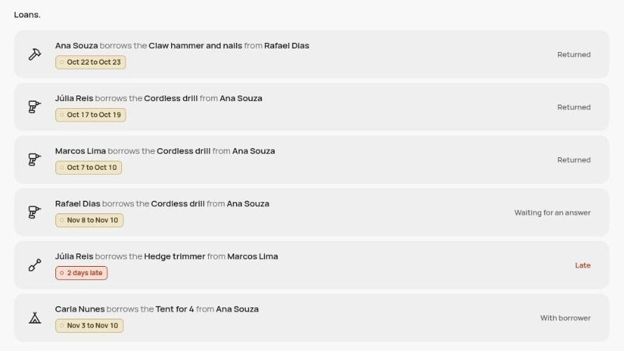
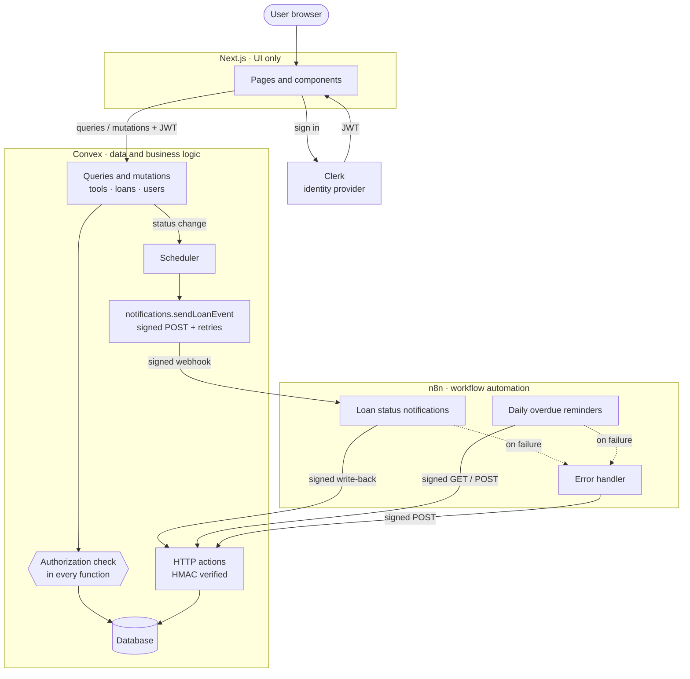
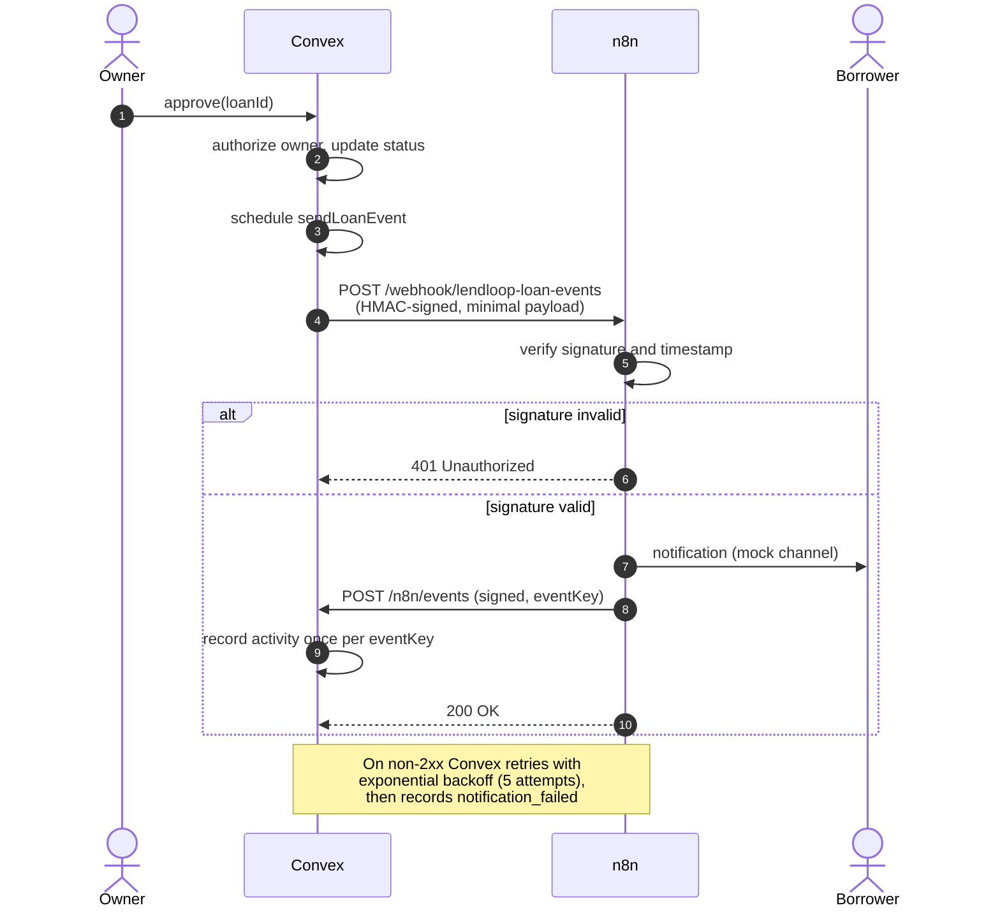
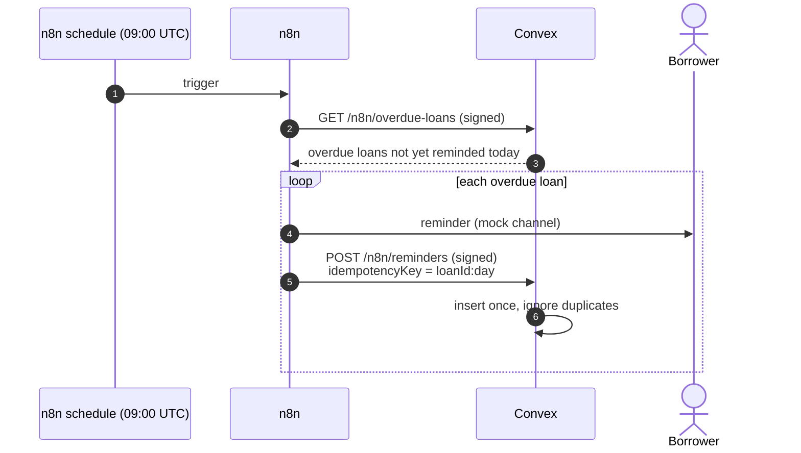
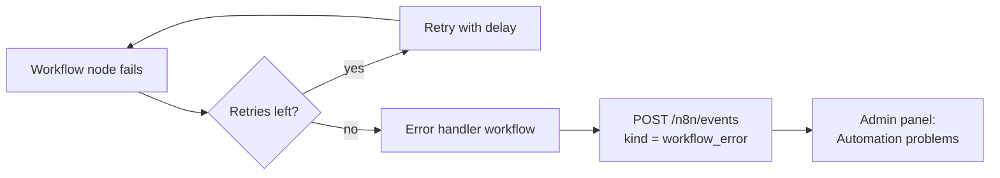
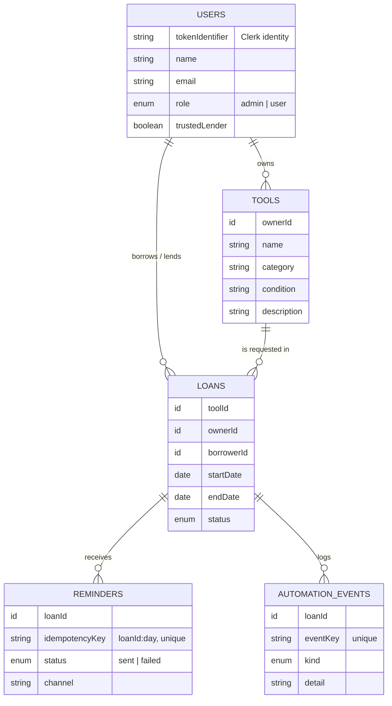
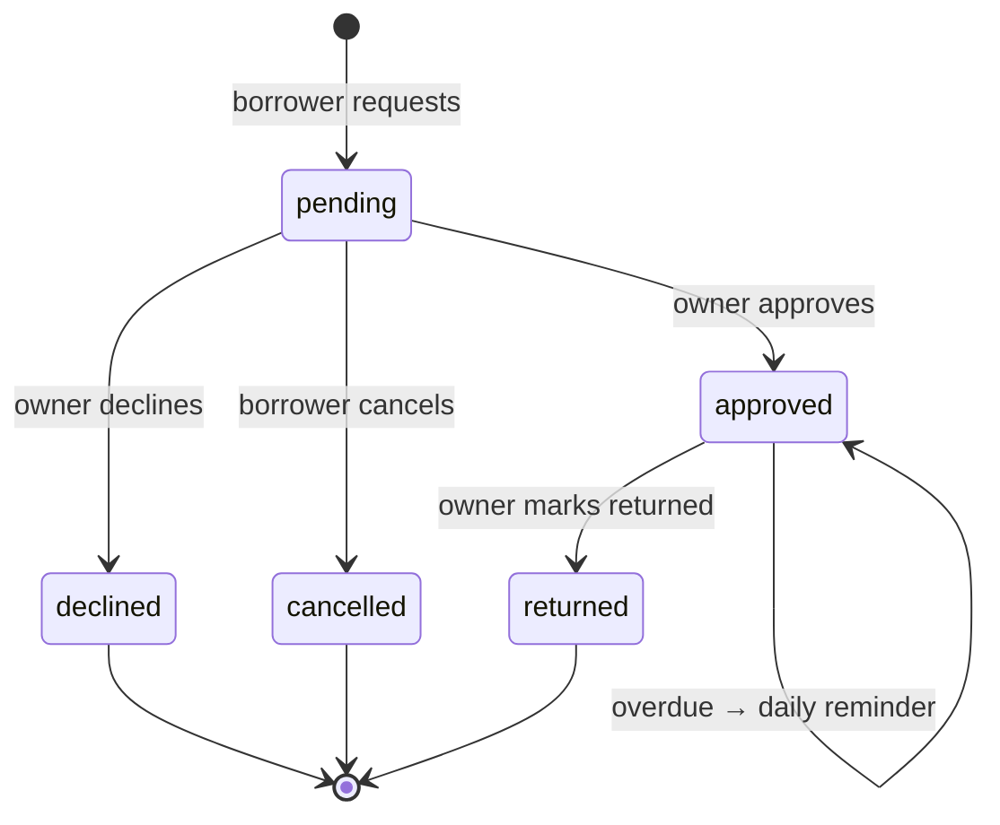

<div align="center">

# LendLoop

**Borrow the drill your neighbor already owns.**

A neighborhood tool-lending board with authenticated listings, date-range borrow requests and secure, idempotent workflow automation.




</div>

---

## Table of contents

- [Overview](#overview)
- [Features](#features)
- [Architecture](#architecture)
- [Automation flows](#automation-flows)
- [Data model](#data-model)
- [Authorization model](#authorization-model)
- [Security and data minimization](#security-and-data-minimization)
- [Getting started](#getting-started)
- [Environment variables](#environment-variables)
- [Testing the integration](#testing-the-integration)
- [Project structure](#project-structure)
- [Running in production](#running-in-production)

---

## Overview

Neighbors list the tools they are willing to lend, other neighbors request them for a date range, and owners approve, decline and mark loans as returned. Two automations run in **n8n**:

| Automation | Trigger | What it does |
|---|---|---|
| **Request notification** | Every loan status change | Notifies the person who needs to act or know, then writes the result back to Convex |
| **Overdue reminder** | Daily at 09:00 UTC | Reminds borrowers of overdue loans and records each reminder exactly once |

Every automation result is written back to the app, so each loan shows its latest activity (*"Reminder sent 2 days ago"*) and admins see failed runs.

| Landing page | Request rows (admin view) |
|---|---|
|  |  |

## Features

| Area | Capabilities |
|---|---|
| **Public page** | Tagline, read-only list of tools available now (**name and category only**, no owner data), sign-in |
| **Browse** | All tools with availability status, category filter and search, borrow request with a date range |
| **My listings** | Create, edit and delete your own tools |
| **My requests** | Your requests grouped by state, cancel while pending, latest automation activity |
| **Incoming** | Approve or decline requests for your tools, mark loans as returned |
| **Admin** | Platform stats, remove any listing, view all loans, mark **Trusted Lenders**, review failed automation runs |

## Architecture



**Design principles**

- **The UI holds no authority.** Next.js renders pages; every read and write goes through Convex functions that re-check identity and role.
- **Automations are isolated.** n8n never touches the database. It talks to Convex only through three signed HTTP endpoints.
- **Every hop is verifiable and repeatable.** Calls are HMAC-signed in both directions, and every write-back is idempotent, so retries are always safe.

## Automation flows

### Request notification



**Who is notified:** a new request goes to the **owner**; approved, declined and returned go to the **borrower**; a cancellation goes to the **owner**.

### Daily overdue reminder



### Failure handling



## Data model



### Loan lifecycle



## Authorization model

All rules are enforced **inside Convex functions** (`convex/lib/auth.ts`), so calling the API directly cannot bypass them.

| Action | user | admin | Enforced by |
|---|:---:|:---:|---|
| View available tools (public) | ✅ | ✅ | `tools.publicList` returns name and category only |
| Create a listing | ✅ | ✅ | `tools.create` |
| Edit or delete a listing | own only | own only | `tools.update` / `tools.remove` check `ownerId` |
| Remove any listing | ❌ | ✅ | `tools.adminRemove` → `requireAdmin` |
| Request to borrow | not own tools | not own tools | `loans.request` |
| Approve, decline, mark returned | own tools only | own tools only | `loans.*` check `loan.ownerId` |
| Cancel a request | own requests only | own requests only | `loans.cancel` checks `loan.borrowerId` |
| View all loans | ❌ | ✅ | `loans.all` → `requireAdmin` |
| Mark Trusted Lender | ❌ | ✅ | `users.setTrustedLender` → `requireAdmin` |

Roles are **never taken from the client**. A user becomes admin only if their email is listed in the `ADMIN_EMAILS` Convex environment variable, or through the operator-only internal mutation `users:setRole`.

## Security and data minimization

| Concern | Decision |
|---|---|
| **Authenticity between services** | Every Convex ⇄ n8n call carries `x-lendloop-timestamp` and `x-lendloop-signature = sha256=HMAC(secret, "ts.METHOD.path.rawBody")`. Binding method and path prevents cross-endpoint replay. Requests older than 5 minutes are rejected, and the comparison is constant-time. n8n verifies against the **raw body**. |
| **Secrets** | `LENDLOOP_WEBHOOK_SECRET` lives only in the Convex env and in the n8n container env (`.env.n8n`, git-ignored). Workflows read it via `$env`. The exported workflow JSON contains no secrets. |
| **Idempotency** | Reminders are keyed by `loanId:day`, and a success is never downgraded. Notification records are keyed by `eventKey`. Retries and repeated schedule runs are no-ops. |
| **No silent failures** | Convex retries the webhook 5 times with exponential backoff, then records `notification_failed`. n8n HTTP nodes retry 3 times, and any failed execution reaches the error workflow, which records a `workflow_error`. |
| **Data minimization** | n8n receives only what one notification needs: recipient name and email, tool name, dates and status. It never gets user ids, roles or other users' data. The public page exposes no owner information. |
| **Input validation** | Field lengths, allowed categories and conditions, date format and range (no past dates, at most 60 days), and shape and size checks on every HTTP payload. |

## Getting started

### Prerequisites

- **Node.js 22+** (see `.nvmrc`)
- **Docker** with Compose
- A free **[Clerk](https://clerk.com)** account

### 1. Install

```bash
npm install
```

### 2. Configure Clerk

1. Create a Clerk application with email sign-in.
2. Go to **Configure → JWT templates → New template → Convex**, keep the name `convex` and save.
3. Copy `.env.local.example` to `.env.local` and fill in `NEXT_PUBLIC_CLERK_PUBLISHABLE_KEY` and `CLERK_SECRET_KEY`.

### 3. Start Convex

```bash
npx convex dev    # creates a deployment (or choose "run locally") and fills CONVEX_* in .env.local
```

In a second terminal:

```bash
SECRET=$(openssl rand -hex 32)
npx convex env set CLERK_JWT_ISSUER_DOMAIN https://<your-instance>.clerk.accounts.dev
npx convex env set LENDLOOP_WEBHOOK_SECRET "$SECRET"
npx convex env set N8N_LOAN_EVENTS_WEBHOOK_URL http://localhost:5678/webhook/lendloop-loan-events
npx convex env set ADMIN_EMAILS you@example.com
npx convex run seed:demo    # optional: five neighbors, seven tools, a late loan and a pending request
                            # (re-running replaces it; `seed:reset` removes it)
```

### 4. Start n8n

```bash
cp .env.n8n.example .env.n8n    # same LENDLOOP_WEBHOOK_SECRET, plus N8N_ENCRYPTION_KEY
docker compose up -d

for f in error-handler loan-events overdue-reminders; do
  docker compose exec n8n n8n import:workflow --input=/workflows/$f.json
done
for id in LendLoopErrorWf1 LendLoopLoanEvts LendLoopOverdue1; do
  docker compose exec n8n n8n publish:workflow --id=$id
done
docker compose restart n8n
```

> **Convex cloud:** a cloud deployment cannot reach `localhost`. Expose n8n with a tunnel (e.g. `cloudflared tunnel --url http://localhost:5678`), use that URL for `N8N_LOAN_EVENTS_WEBHOOK_URL`, and set `LENDLOOP_CONVEX_SITE_URL` to `https://<deployment>.convex.site`.

### 5. Run the app

```bash
npm run dev    # http://localhost:3000
```

The n8n editor is available at http://localhost:5678.

## Environment variables

| Location | Variable | Purpose |
|---|---|---|
| `.env.local` | `CONVEX_DEPLOYMENT`, `NEXT_PUBLIC_CONVEX_URL` | Set automatically by `npx convex dev` |
| `.env.local` | `NEXT_PUBLIC_CLERK_PUBLISHABLE_KEY`, `CLERK_SECRET_KEY` | Clerk application keys |
| Convex env | `CLERK_JWT_ISSUER_DOMAIN` | Clerk Frontend API URL, used to verify JWTs |
| Convex env | `LENDLOOP_WEBHOOK_SECRET` | Shared HMAC secret (32+ characters) |
| Convex env | `N8N_LOAN_EVENTS_WEBHOOK_URL` | n8n webhook that receives loan events |
| Convex env | `ADMIN_EMAILS` | Comma-separated emails promoted to admin on sign-in |
| `.env.n8n` | `N8N_ENCRYPTION_KEY` | Encrypts credentials stored by n8n |
| `.env.n8n` | `LENDLOOP_WEBHOOK_SECRET` | Same shared secret |
| `.env.n8n` | `LENDLOOP_CONVEX_SITE_URL` | Convex HTTP actions base URL, as seen from the container |

## Testing the integration

```bash
export LENDLOOP_WEBHOOK_SECRET=<same secret>

# Signed request → 200 with overdue loans; unsigned → 401
node scripts/signed-request.mjs GET http://127.0.0.1:3211/n8n/overdue-loans
curl -i http://127.0.0.1:3211/n8n/overdue-loans

# Run the reminder workflow on demand
docker compose exec -e N8N_RUNNERS_BROKER_PORT=5690 n8n n8n execute --id=LendLoopOverdue1
```

| Scenario | Expected result | Verified |
|---|---|:---:|
| Valid signature (both directions) | `200` | ✅ |
| Forged, stale or missing signature | `401` | ✅ |
| Reminder workflow run twice the same day | One reminder per loan | ✅ |
| n8n offline during a status change | 5 retries, then `notification_failed` on the loan | ✅ |
| Failing workflow node | `workflow_error` recorded and visible to admins | ✅ |

## Project structure

```
.
├── app/                    Next.js routes
│   ├── page.tsx            Public landing page
│   └── app/                Signed-in area (browse, listings, requests, incoming, admin)
├── components/             UI building blocks and the app shell
├── convex/
│   ├── schema.ts           Data model
│   ├── lib/auth.ts         requireUser / requireAdmin
│   ├── lib/hmac.ts         Signing and verification
│   ├── tools.ts            Listings
│   ├── loans.ts            Borrow requests and lifecycle
│   ├── users.ts            Profiles, roles, Trusted Lender
│   ├── notifications.ts    Signed webhook to n8n with retries
│   ├── automation.ts       Overdue query and idempotent write-backs
│   └── http.ts             HMAC-verified endpoints for n8n
├── n8n/workflows/          Exported workflows (no secrets)
├── scripts/                Signed request helper
└── docker-compose.yml      n8n
```

## Running in production

- **Real channels.** Replace the mock notification nodes with email (Resend, SES) or Slack, and dedupe sends by `eventKey` in n8n so a redelivered webhook never sends twice.
- **Delivery guarantees.** Persist outgoing events in an outbox table, mark them delivered on a 2xx, and alert on undelivered events.
- **Secret management.** Rotate with two active secrets and a key id header, inject secrets through n8n external secrets, and set `N8N_BLOCK_ENV_ACCESS_IN_NODE=true`.
- **Replay protection.** Store recent signatures for the tolerance window and reject repeats.
- **n8n at scale.** Postgres instead of SQLite, queue mode with workers, HTTPS and network allow-listing between Convex and n8n.
- **Time zones.** Store each user's time zone and send reminders in their local morning.
- **Performance.** Paginate list queries, add indexes for admin views, and denormalize tool availability.
- **Quality.** `convex-test` coverage for every authorization rule, an end-to-end signed round trip in CI, and centralized logs with alerts on `workflow_error` and `notification_failed`.
- **Privacy.** Per-user rate limits, an audit log for admin actions, and account deletion that anonymizes loan history.
