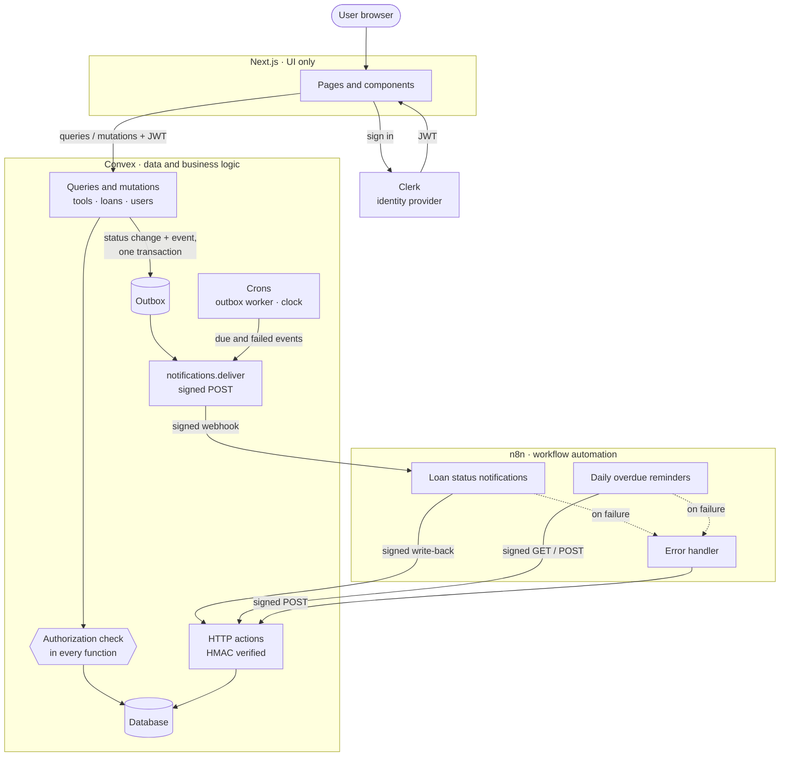
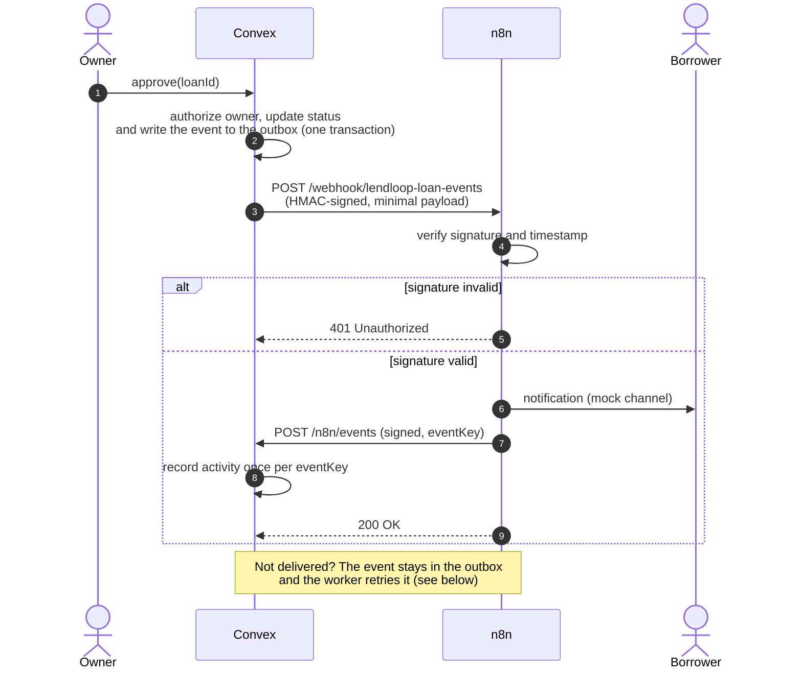
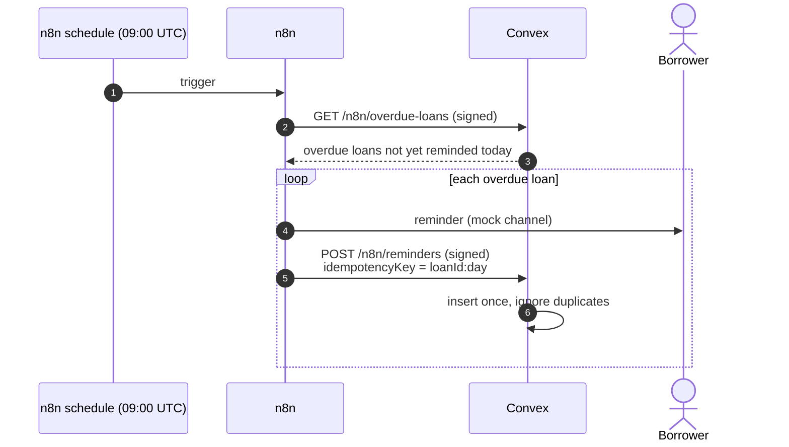
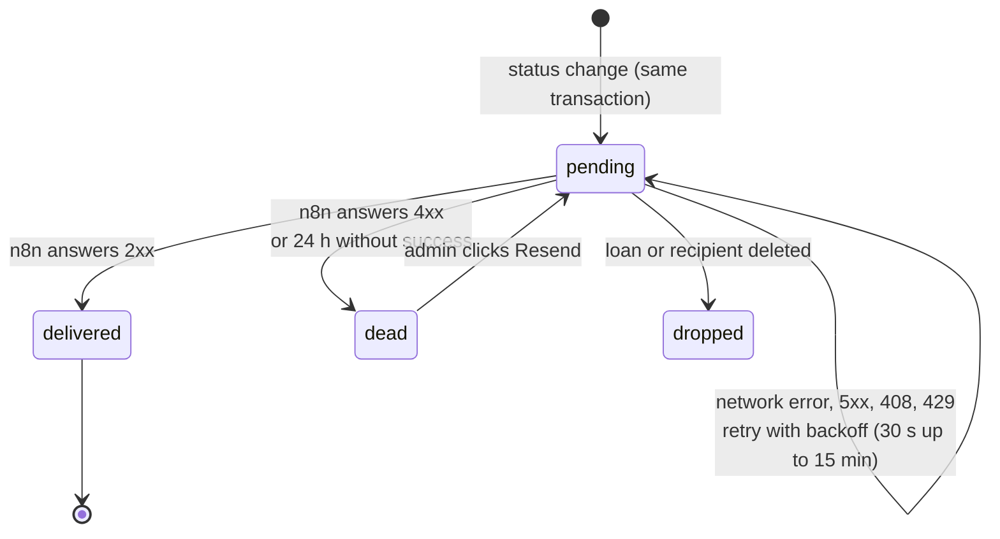
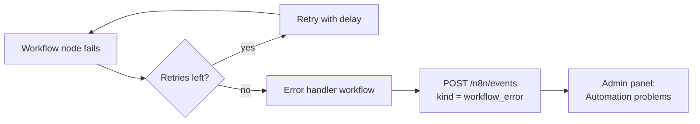
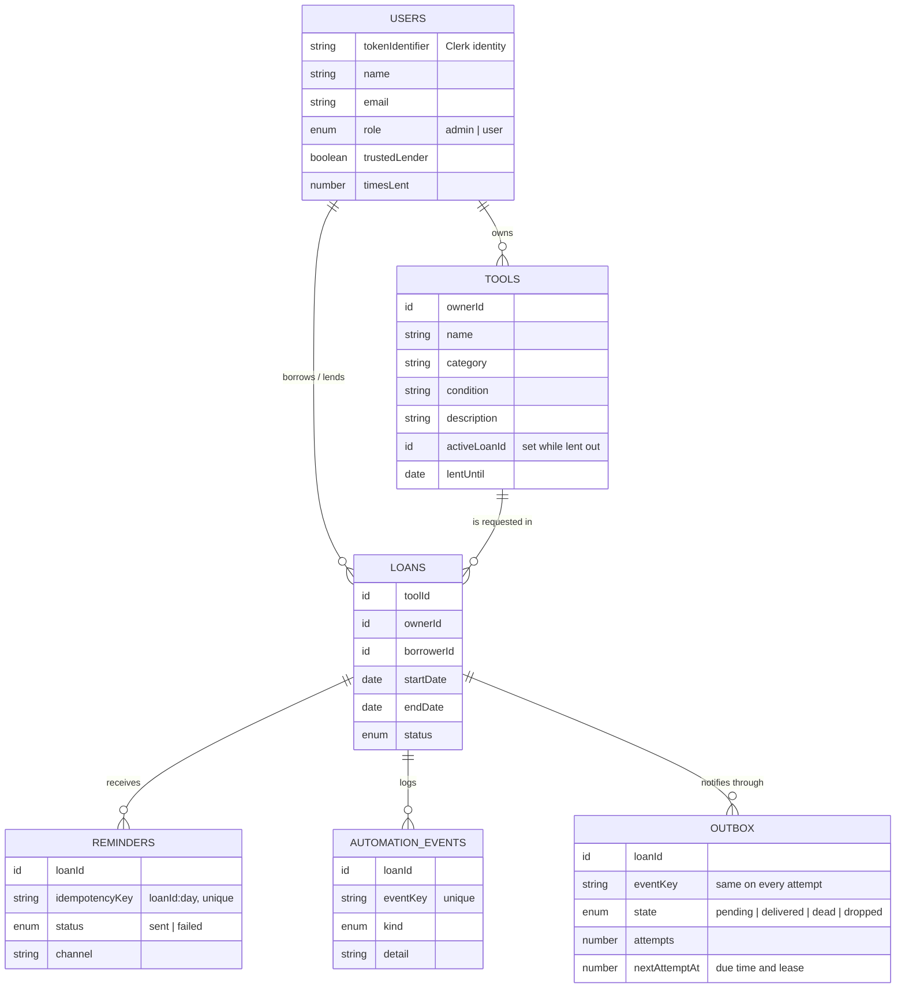
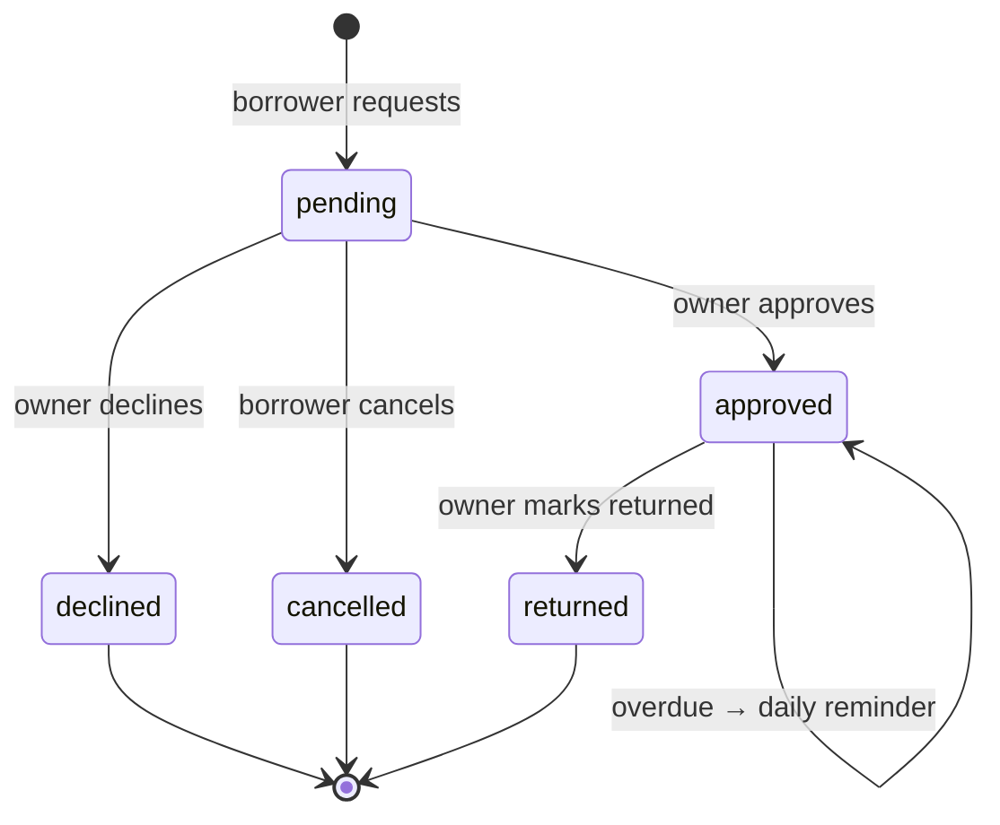
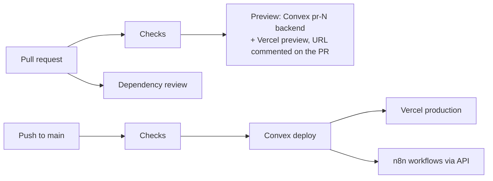

<div align="center">

# LendLoop

**Borrow the drill your neighbor already owns.**

A neighborhood tool-lending board with authenticated listings, date-range borrow requests and secure, idempotent workflow automation.


</div>

---

## Table of contents

- [Overview](#overview)
- [Features](#features)
- [Architecture](#architecture)
- [Automation flows](#automation-flows)
- [Scaling and reliability](#scaling-and-reliability)
- [Data model](#data-model)
- [Authorization model](#authorization-model)
- [Security and data minimization](#security-and-data-minimization)
- [Getting started](#getting-started)
- [Environment variables](#environment-variables)
- [Testing](#testing)
- [CI/CD](#cicd)
- [Project structure](#project-structure)
- [Running in production](#running-in-production)

---

## Overview

Neighbors list the tools they are willing to lend, other neighbors request them for a date range, and owners approve, decline and mark loans as returned. Two automations run in **n8n**:

| Automation | Trigger | What it does |
|---|---|---|
| **Request notification** | Every loan status change | Notifies the person who needs to act or know, then writes the result back to Convex |
| **Overdue reminder** | Daily at 09:00 UTC | Reminds borrowers of overdue loans and records each reminder exactly once |

Every automation result is written back to the app, so each loan shows its latest activity (*"Reminder sent 2 days ago"*) and admins see failed runs.

| Landing page | Request rows (admin view) |
|---|---|
|  |  |

## Features

| Area | Capabilities |
|---|---|
| **Public page** | Tagline, read-only list of tools available now (**name and category only**, no owner data), sign-in |
| **Browse** | All tools with availability status, category filter and search, borrow request with a date range |
| **My listings** | Create, edit and delete your own tools |
| **My requests** | Your requests grouped by state, cancel while pending, latest automation activity |
| **Incoming** | Approve or decline requests for your tools, mark loans as returned |
| **Admin** | Platform stats, remove any listing, view all loans, mark **Trusted Lenders**, review failed automation runs |

## Architecture



**Design principles**

- **The UI holds no authority.** Next.js renders pages; every read and write goes through Convex functions that re-check identity and role.
- **Automations are isolated.** n8n never touches the database. It talks to Convex only through three signed HTTP endpoints.
- **Every hop is verifiable and repeatable.** Calls are HMAC-signed in both directions, and every write-back is idempotent, so retries are always safe.

## Automation flows

### Request notification



**Who is notified:** a new request goes to the **owner**; approved, declined and returned go to the **borrower**; a cancellation goes to the **owner**.

### Daily overdue reminder



### Notification delivery (outbox)

A status change and its notification are written in **one transaction**, so the event exists exactly when the change does. Delivery is then retried until n8n takes it:



- **Deploys and restarts lose nothing.** Each attempt holds a 2-minute lease on its row. If the process dies mid-attempt, the lease runs out and the worker (a Convex cron, every minute) picks the row up again. Requests time out after 30 s, well inside the lease, so a slow attempt is never sent twice in parallel.
- **Circuit breaker.** The first transient failure marks n8n as down. While it is down the worker sends **one probe per minute** instead of the whole backlog. The first success marks it up and sends the backlog at once. Admins see a banner while n8n is down.
- **At least once.** The `eventKey` is the same on every attempt (`loanId:status`), so the write-back to Convex is deduplicated and a real channel can use it as its idempotency key.

### Failure handling



## Scaling and reliability

| Question | Answer |
|---|---|
| **Cache?** | Convex caches every query result and re-runs it only when a document it read changes, then pushes the new result over the open WebSocket. The public list reads no identity, so all visitors share one cached result. An extra cache (Redis) would add a second source of truth for no gain. |
| **Time in cached queries** | A query that called `Date.now()` would keep yesterday's answer until some data changed. Queries read the current day from a stored document instead, and a cron advances it, which refreshes every query that depends on the date ("late", "with borrower"). |
| **Queue?** | The outbox table is the queue: written in the same transaction as the change, drained by a cron worker, with leases, backoff and a circuit breaker. An external broker (SQS, RabbitMQ) would add a second system that cannot join the Convex transaction. |
| **Concurrency** | Convex mutations are serializable transactions. Two owners approving overlapping loans at the same moment cannot both succeed: one is retried and then fails the overlap check. |
| **Read cost** | Lists never scan loans. Each tool stores whether it is lent out and until when, each user stores how many times they have lent, and header counters live in one document. All are updated by the mutations that change them, and `stats:recompute` rebuilds them from raw data. |
| **Large lists** | The board and the admin lists are paginated; search runs on the server through a full-text index on the tool name. A person's own requests show the latest 200. |

**Known limits.** The counters live in one document, so at very high write rates (thousands of new listings per second) they would conflict and should be sharded. n8n runs as a single container with SQLite, which is a single point of failure for the automations (notifications wait in the outbox, but the daily reminder is skipped if n8n is down at 09:00).

## Data model



### Loan lifecycle



## Authorization model

All rules are enforced **inside Convex functions** (`convex/lib/auth.ts`), so calling the API directly cannot bypass them.

| Action | user | admin | Enforced by |
|---|:---:|:---:|---|
| View available tools (public) | ✅ | ✅ | `tools.publicList` returns name and category only |
| Create a listing | ✅ | ✅ | `tools.create` |
| Edit or delete a listing | own only | own only | `tools.update` / `tools.remove` check `ownerId` |
| Remove any listing | ❌ | ✅ | `tools.adminRemove` → `requireAdmin` |
| Request to borrow | not own tools | not own tools | `loans.request` |
| Approve, decline, mark returned | own tools only | own tools only | `loans.*` check `loan.ownerId` |
| Cancel a request | own requests only | own requests only | `loans.cancel` checks `loan.borrowerId` |
| View all loans | ❌ | ✅ | `loans.all` → `requireAdmin` |
| Mark Trusted Lender | ❌ | ✅ | `users.setTrustedLender` → `requireAdmin` |

Roles are **never taken from the client**. A user becomes admin only if their email is listed in the `ADMIN_EMAILS` Convex environment variable, or through the operator-only internal mutation `users:setRole`.

## Security and data minimization

| Concern | Decision |
|---|---|
| **Authenticity between services** | Every Convex ⇄ n8n call carries `x-lendloop-timestamp` and `x-lendloop-signature = sha256=HMAC(secret, "ts.METHOD.path.rawBody")`. Binding method and path prevents cross-endpoint replay. Requests older than 5 minutes are rejected, and the comparison is constant-time. n8n verifies against the **raw body**. |
| **Secrets** | `LENDLOOP_WEBHOOK_SECRET` lives only in the Convex env and in the n8n container env (`.env.n8n`, git-ignored). Workflows read it via `$env`. The exported workflow JSON contains no secrets. |
| **Idempotency** | Reminders are keyed by `loanId:day`, and a success is never downgraded. Notification records are keyed by `eventKey`. Retries and repeated schedule runs are no-ops. |
| **No silent failures** | Notifications go through a transactional outbox with retries, a circuit breaker and a 24-hour window, then `notification_failed` with a Resend button for admins. n8n HTTP nodes retry 3 times, and any failed execution reaches the error workflow, which records a `workflow_error`. |
| **Data minimization** | n8n receives only what one notification needs: recipient name and email, tool name, dates and status. It never gets user ids, roles or other users' data. The public page exposes no owner information. |
| **Input validation** | Field lengths, allowed categories and conditions, date format and range (no past dates, at most 60 days), and shape and size checks on every HTTP payload. |

## Getting started

### Prerequisites

- **Node.js 22+** (see `.nvmrc`)
- **Docker** with Compose
- A free **[Clerk](https://clerk.com)** account

### 1. Install

```bash
npm install
```

### 2. Configure Clerk

1. Create a Clerk application with email sign-in.
2. Go to **Configure → JWT templates → New template → Convex**, keep the name `convex` and save.
3. Copy `.env.local.example` to `.env.local` and fill in `NEXT_PUBLIC_CLERK_PUBLISHABLE_KEY` and `CLERK_SECRET_KEY`.

### 3. Start Convex

```bash
npx convex dev    # creates a deployment (or choose "run locally") and fills CONVEX_* in .env.local
```

In a second terminal:

```bash
SECRET=$(openssl rand -hex 32)
npx convex env set CLERK_JWT_ISSUER_DOMAIN https://<your-instance>.clerk.accounts.dev
npx convex env set LENDLOOP_WEBHOOK_SECRET "$SECRET"
npx convex env set N8N_LOAN_EVENTS_WEBHOOK_URL http://localhost:5678/webhook/lendloop-loan-events
npx convex env set ADMIN_EMAILS you@example.com
npx convex run seed:demo    # optional: five neighbors, seven tools, a late loan and a pending request
                            # (re-running replaces it; `seed:reset` removes it;
                            #  '{"extraTools": 40}' adds filler tools to try paging)
```

### 4. Start n8n

```bash
cp .env.n8n.example .env.n8n    # same LENDLOOP_WEBHOOK_SECRET, plus N8N_ENCRYPTION_KEY
docker compose up -d

for f in error-handler loan-events overdue-reminders; do
  docker compose exec n8n n8n import:workflow --input=/workflows/$f.json
done
for id in LendLoopErrorWf1 LendLoopLoanEvts LendLoopOverdue1; do
  docker compose exec n8n n8n publish:workflow --id=$id
done
docker compose restart n8n
```

> **Convex cloud:** a cloud deployment cannot reach `localhost`. Expose n8n with a tunnel (e.g. `cloudflared tunnel --url http://localhost:5678`), use that URL for `N8N_LOAN_EVENTS_WEBHOOK_URL`, and set `LENDLOOP_CONVEX_SITE_URL` to `https://<deployment>.convex.site`.

### 5. Run the app

```bash
npm run dev    # http://localhost:3000
```

The n8n editor is available at http://localhost:5678.

## Environment variables

| Location | Variable | Purpose |
|---|---|---|
| `.env.local` | `CONVEX_DEPLOYMENT`, `NEXT_PUBLIC_CONVEX_URL` | Set automatically by `npx convex dev` |
| `.env.local` | `NEXT_PUBLIC_CLERK_PUBLISHABLE_KEY`, `CLERK_SECRET_KEY` | Clerk application keys |
| Convex env | `CLERK_JWT_ISSUER_DOMAIN` | Clerk Frontend API URL, used to verify JWTs |
| Convex env | `LENDLOOP_WEBHOOK_SECRET` | Shared HMAC secret (32+ characters) |
| Convex env | `N8N_LOAN_EVENTS_WEBHOOK_URL` | n8n webhook that receives loan events |
| Convex env | `ADMIN_EMAILS` | Comma-separated emails promoted to admin on sign-in |
| `.env.n8n` | `N8N_ENCRYPTION_KEY` | Encrypts credentials stored by n8n |
| `.env.n8n` | `LENDLOOP_WEBHOOK_SECRET` | Same shared secret |
| `.env.n8n` | `LENDLOOP_CONVEX_SITE_URL` | Convex HTTP actions base URL, as seen from the container |

## Testing

### Automated tests

```bash
npm test          # 52 tests, no external services needed
npm run typecheck
```

The suite runs every Convex function against an in-memory backend (`convex-test`):

| File | What it proves |
|---|---|
| `convex/users.test.ts` | Roles come only from `ADMIN_EMAILS`; only admins list users and mark Trusted Lenders |
| `convex/tools.test.ts` | Public list leaks no owner data; validation; only owners edit or delete; admin removal; no deleting a tool that is lent out; pages, server search and counters |
| `convex/loans.test.ts` | Date rules, no borrowing your own tool, no overlapping approvals, who can approve, decline, return and cancel, and who gets notified |
| `convex/automation.test.ts` | Unsigned, forged, stale and cross-endpoint calls get `401`; reminders are idempotent; workflow errors reach admins |
| `convex/outbox.test.ts` | Signed minimal payload; n8n down then back; an attempt killed mid-flight (deploy) is picked up after its lease; one probe while n8n is down, then the backlog; 4xx and 24 h give up; admin resend |
| `convex/clock.test.ts` | Tools go out on the loan's start day, loans turn late the next day, a late tool stays with its borrower |
| `convex/hmac.test.ts` | Signature, tampering, replay and tolerance rules |

### Manual integration check

```bash
export LENDLOOP_WEBHOOK_SECRET=<same secret>

# Signed request → 200 with overdue loans; unsigned → 401
node scripts/signed-request.mjs GET http://127.0.0.1:3211/n8n/overdue-loans
curl -i http://127.0.0.1:3211/n8n/overdue-loans

# Run the reminder workflow on demand
docker compose exec -e N8N_RUNNERS_BROKER_PORT=5690 n8n n8n execute --id=LendLoopOverdue1
```

| Scenario | Expected result | Verified |
|---|---|:---:|
| Valid signature (both directions) | `200` | ✅ |
| Forged, stale or missing signature | `401` | ✅ |
| Reminder workflow run twice the same day | One reminder per loan | ✅ |
| n8n offline during a status change | Event waits in the outbox and goes out when n8n is back | ✅ |
| Failing workflow node | `workflow_error` recorded and visible to admins | ✅ |

## CI/CD

GitHub Actions, in `.github/workflows/`:



| Pipeline | Runs on | What it does |
|---|---|---|
| `checks.yml` | Called by the two below | Lint, typecheck, tests; n8n workflow JSON has no inline secrets; Compose file is valid; Next.js build |
| `pull-request.yml` | Every PR to `main` | Checks, dependency review (fails on high-severity advisories), preview deployment with its own seeded Convex backend |
| `deploy.yml` | Push to `main`, or manually | Checks, then Convex functions and schema, then the web app and the n8n workflows. One deploy at a time |

Every job that needs credentials checks for them first and **skips with a notice** when they are missing, so the pipelines are green on a fresh fork. To turn each part on:

| Name | Kind | Enables |
|---|---|---|
| `NEXT_PUBLIC_CONVEX_URL`, `NEXT_PUBLIC_CLERK_PUBLISHABLE_KEY` | Variable | Build step in checks |
| `CONVEX_DEPLOY_KEY` | Secret (`production` environment) | Convex deploy |
| `CONVEX_PREVIEW_DEPLOY_KEY` | Secret (`preview` environment) | Per-PR backends |
| `VERCEL_TOKEN` | Secret | Web deploy and previews |
| `VERCEL_ORG_ID`, `VERCEL_PROJECT_ID` | Variable | Web deploy and previews |
| `N8N_API_URL` | Variable | n8n workflow deploy |
| `N8N_API_KEY` | Secret (`production` environment) | n8n workflow deploy |

After deploying a version that adds stored counters to a deployment that already has data, run `npx convex run stats:recompute` once. Convex env vars (`CLERK_JWT_ISSUER_DOMAIN`, `LENDLOOP_WEBHOOK_SECRET`, ...) are set once in the Convex dashboard, including the defaults for preview deployments. The n8n deploy only **updates** workflows that already exist, so the first import is the manual one from [Start n8n](#4-start-n8n). Dependabot opens weekly update PRs for npm packages and actions.

## Project structure

```
.
├── app/                    Next.js routes
│   ├── page.tsx            Public landing page
│   └── app/                Signed-in area (browse, listings, requests, incoming, admin)
├── components/             UI building blocks and the app shell
├── convex/
│   ├── *.test.ts           Automated tests (never deployed)
│   ├── schema.ts           Data model
│   ├── lib/auth.ts         requireUser / requireAdmin
│   ├── lib/hmac.ts         Signing and verification
│   ├── tools.ts            Listings
│   ├── loans.ts            Borrow requests and lifecycle
│   ├── users.ts            Profiles, roles, Trusted Lender
│   ├── notifications.ts    Outbox, delivery worker, circuit breaker, resend
│   ├── clock.ts            Daily clock: stored day and loans that start today
│   ├── crons.ts            Outbox worker (every minute) and clock (every 10 minutes)
│   ├── stats.ts            Admin counters and the recompute tool
│   ├── automation.ts       Overdue query and idempotent write-backs
│   └── http.ts             HMAC-verified endpoints for n8n
├── n8n/workflows/          Exported workflows (no secrets)
├── scripts/                Signed request helper, n8n workflow check and deploy
├── .github/                CI/CD pipelines and Dependabot
└── docker-compose.yml      n8n
```

## Running in production

- **Real channels.** Replace the mock notification nodes with email (Resend, SES) or Slack, passing `eventKey` as the provider's idempotency key so a redelivered event never sends twice.
- **Delivery alerts.** Page someone when n8n has been marked down for more than a few minutes, not only show it in the admin panel.
- **Secret management.** Rotate with two active secrets and a key id header, inject secrets through n8n external secrets, and set `N8N_BLOCK_ENV_ACCESS_IN_NODE=true`.
- **Replay protection.** Store recent signatures for the tolerance window and reject repeats.
- **n8n at scale.** Postgres instead of SQLite, queue mode with workers, HTTPS and network allow-listing between Convex and n8n.
- **Time zones.** Store each user's time zone and send reminders in their local morning.
- **Reminder schedule.** Trigger the daily reminder from a Convex cron (or have n8n catch up missed days), so an n8n outage at 09:00 does not skip a day.
- **Quality.** An end-to-end signed round trip against a real n8n container in CI, and centralized logs with alerts on `workflow_error` and `notification_failed`.
- **Privacy.** Per-user rate limits, an audit log for admin actions, and account deletion that anonymizes loan history.
